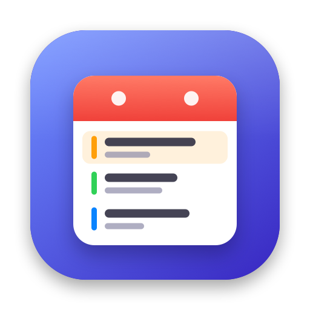
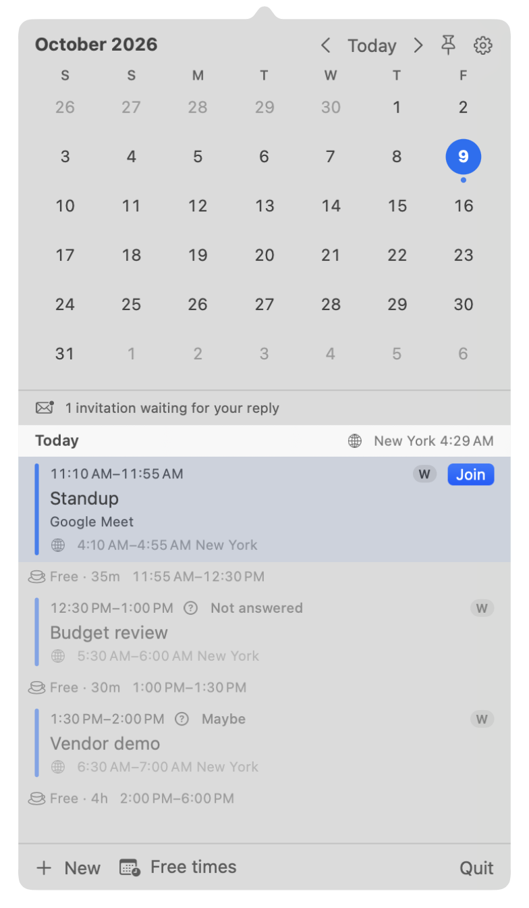
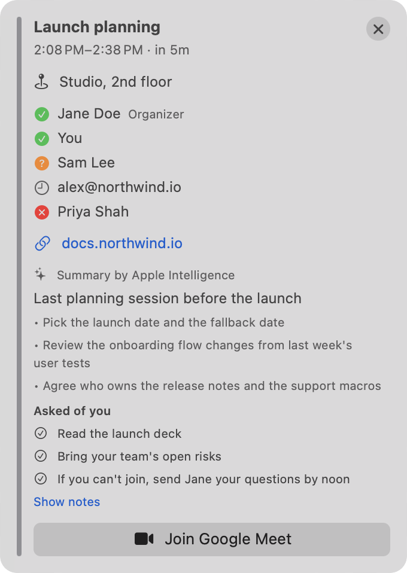
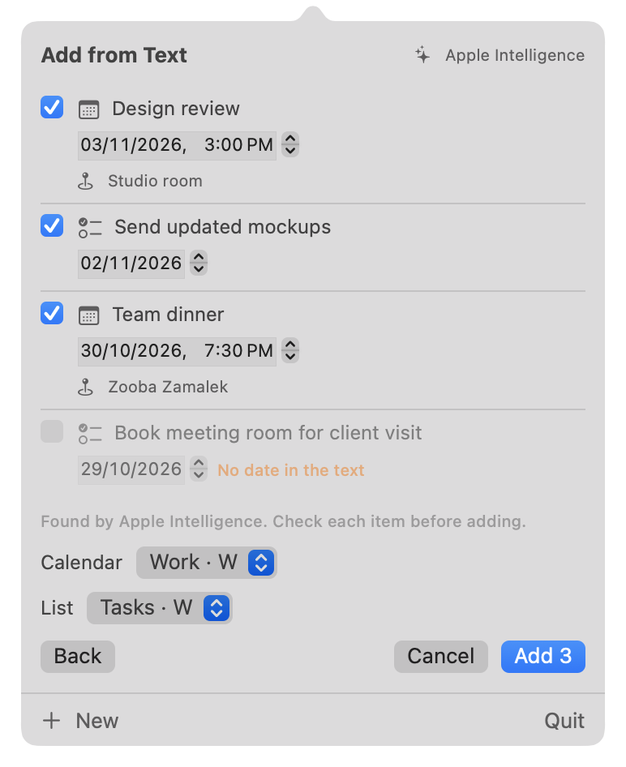

<p align="center"></p>

<h1 align="center">Soonbar</h1>

<p align="center">Your next meeting in the menu bar, and the rest of your week one click away.<br>
A small, native calendar for macOS. Free, open source, and private.</p>


## Install

```bash
curl -fsSL https://raw.githubusercontent.com/AhmedEzzat12/soonbar/main/scripts/install-latest.sh | bash
```

Then click the calendar icon in the menu bar → **Grant Access**. It updates itself from then on.
macOS 14 or later. Other ways to install, and what to do if macOS blocks the app: **[install guide](docs/INSTALL.md)**.

## What it does

- **Your next event in the menu bar**, counting down: `Standup · in 12m`
- **A month and an agenda** for every calendar and reminder list on your Mac, all accounts together
- **Quick add from anywhere** (⌥⌘N): type `Lunch with Sara tomorrow 1pm`
- **One-click Join** for Zoom, Meet, Teams and more (⌥⌘J), and a **full-screen alert** you can snooze
- **Reminders in the agenda:** tick them off, open them, or push them to later

**Turn on what you need** in Settings:

| Feature | What it does |
|---|---|
| **Meeting brief** | Who's coming, links and notes, just before a meeting. Apple Intelligence can sum up long notes. |
| **Add from Text** | Paste an email or chat, tick the events and reminders in it |
| **Free times** | Copy your open slots to share them |
| **Second time zone** | Meeting times and a clock for another city |
| **Back-to-back marks** | Spot meetings with no break before them |
| **Invitations** | See which invitations you haven't answered |
| **Shortcuts** | Run a Shortcut when a meeting starts or ends, like Do Not Disturb |

<table>
  <tr>
    <td></td>
    <td></td>
    <td></td>
  </tr>
  <tr>
    <td align="center">Agenda</td>
    <td align="center">Meeting brief</td>
    <td align="center">Add from Text</td>
  </tr>
</table>

## Private by design

Soonbar uses the calendars and reminders already on your Mac. There are no accounts, servers or tracking, and
the Apple Intelligence features run on your Mac.

## More

- **[Using Soonbar](docs/USAGE.md)**: quick-add phrases, keyboard shortcuts, every setting
- **[Install guide](docs/INSTALL.md)**: download, build from source, fixing "Apple could not verify…"
- **[How it works](docs/ARCHITECTURE.md)** · **[Developer guide](docs/DEVELOPMENT.md)** · **[Contributing](CONTRIBUTING.md)**

[MIT](LICENSE) © 2026 Ahmed Ezzat. Updates use [Sparkle](https://github.com/sparkle-project/Sparkle) (MIT-style
license).
